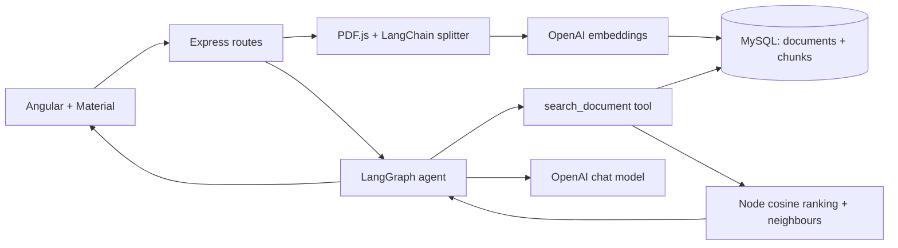

# Clausedesk

A small legal PDF workspace built with Angular 19, Express, TypeScript and MySQL. Upload a searchable PDF, wait for processing, and ask questions with page-level source references.

## Run locally

You need **Node 22.13+ (22.x)**, **MySQL 8+**, and an OpenAI API key with billing and model access. No other database is used.

```sh
npm ci
```

Copy `.env.example` to `.env` (`Copy-Item .env.example .env` in PowerShell). In MySQL, create an empty `legal_assistant` database and a local application user with access to that database. Set your own password; do not use the root account in the application.

Update these values in `.env`:

```dotenv
MYSQL_HOST=127.0.0.1
MYSQL_PORT=3306
MYSQL_DATABASE=legal_assistant
MYSQL_USER=your_local_user
MYSQL_PASSWORD=your_local_password
OPENAI_API_KEY=your_openai_key
```

Keep the remaining defaults, then run:

```sh
npm run db:migrate
npm run build
npm start
```

Open **http://localhost:3003**. The server binds to localhost. Stop with Ctrl+C. Rebuild after editing source files. `npm run dev` builds and starts the same application.

The key stays on the server. Without a key, the workspace opens but upload/AI actions return an explicit configuration error. There are no fake answers or substitute embeddings. Original PDFs are saved under the ignored `storage/uploads` directory.

## Try it

`demo/sample-services-agreement.pdf` is a fictional five-page agreement. Upload it and wait for **ready**. Example questions:

1. When must undisputed invoices be paid?
2. What notice and cure periods apply to termination?
3. How does termination affect outstanding payments? (pages 2 and 4)
4. Which confidentiality obligations survive termination?
5. What is the liability cap, and what are its exceptions?
6. Which arbitration venue is specified? (not provided)

Expand each source to check its page, heading and supporting text. `npm run demo:pdf` regenerates the sample.

## Checks

```sh
npm test
npm run typecheck
npm run build
npm run format:check
npm run test:e2e
```

Browser tests use installed Microsoft Edge. For another OS, remove `channel: 'msedge'` from `playwright.config.ts` and install Chromium with `npx playwright install chromium`. Start MySQL and migrate before browser tests. The missing-key browser test expects an empty `OPENAI_API_KEY`; the chat UI test uses explicitly controlled API responses.

For the real MySQL integration test, create a separate `legal_assistant_test` database, grant the same local user access, and run in PowerShell:

```powershell
$env:MYSQL_DATABASE='legal_assistant_test'
npm run db:migrate
npx vitest run tests/mysql.test.ts --config vitest.mysql.config.ts
Remove-Item Env:MYSQL_DATABASE
```

The test refuses a database whose name does not end in `_test`. It cleans up its own rows. Unit tests use deterministic test doubles for OpenAI; they do not verify model quality. See [verification](docs/VERIFICATION.md) for the checks actually run and the live-key checklist.

## How it works

PDF.js extracts text page by page. LangChain splits sections into chunks of up to 650 tokens with 100-token overlap; short clauses stay short. MySQL stores text, page/heading metadata and OpenAI embedding arrays. A LangGraph agent decides which searches to run, with a maximum of four tool executions. Retrieval uses real cosine similarity and includes neighbouring chunks to connect clauses across pages. Answers are accepted only with references to retrieved chunk IDs; unsupported/malformed output becomes a clear missing-information response.



`client/` contains standalone components and services. `server/` contains routes/controllers, PDF processing, MySQL persistence, retrieval and the agent. `sql/001_initial.sql` is the idempotent initial migration. [API endpoints](docs/API.md) and a short [implementation walkthrough](docs/WALKTHROUGH.md) explain the details.

This is a single-user local POC: it has no authentication or tenant separation. Do not expose it publicly or upload confidential client files without permission. PDF text is sent to OpenAI. Image-only PDFs require OCR; the app reports that requirement. Failed jobs keep their status and partial chunks for inspection, and retry clears them before rebuilding. Interrupted in-process jobs are marked failed on restart. Queue durability and background workers are future improvements.

Retrieval scans all embeddings for one document: time is O(chunks × dimensions), with those vectors held in Node memory. This is reasonable for a bounded POC, but an indexed search system would be needed for large document libraries. Citation ID validation does not prove that every legal interpretation is correct; review the clauses. Angular 19 is retained because the assignment specifies it; it is outside support and dependency audit findings are recorded in verification. Upgrade before production.

Official references: [Angular compatibility](https://angular.dev/reference/versions), [LangGraph agents](https://docs.langchain.com/oss/javascript/langgraph/workflows-agents), [OpenAI embeddings](https://developers.openai.com/api/docs/guides/embeddings).
